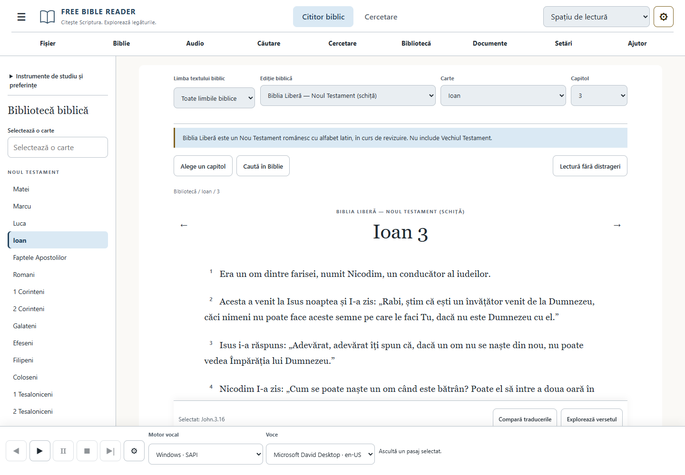
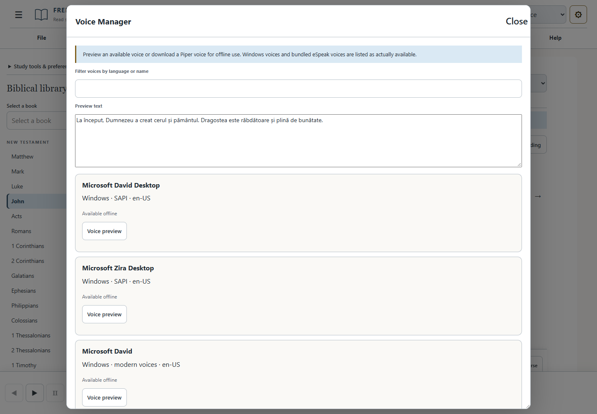
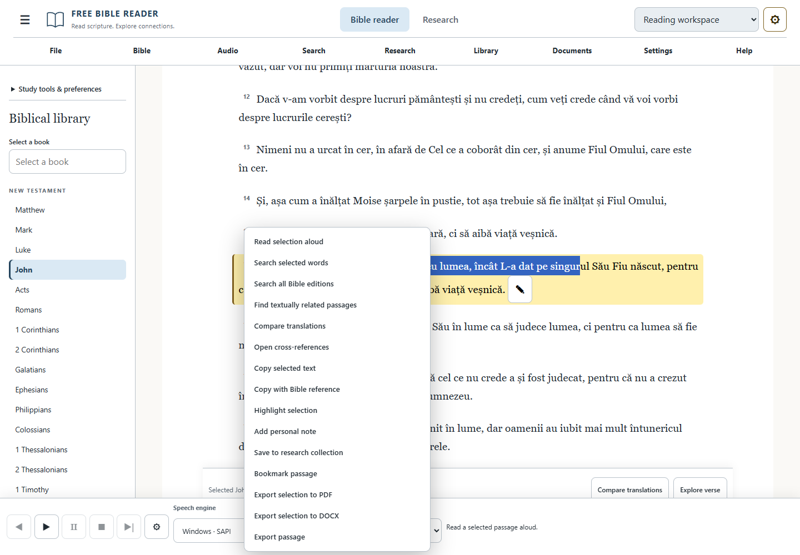
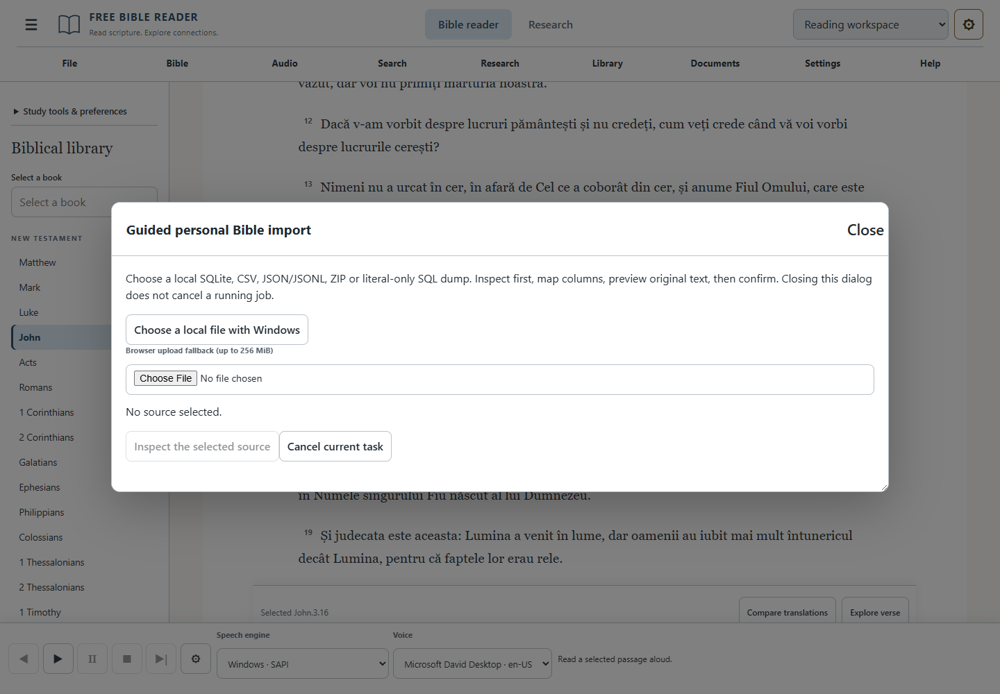
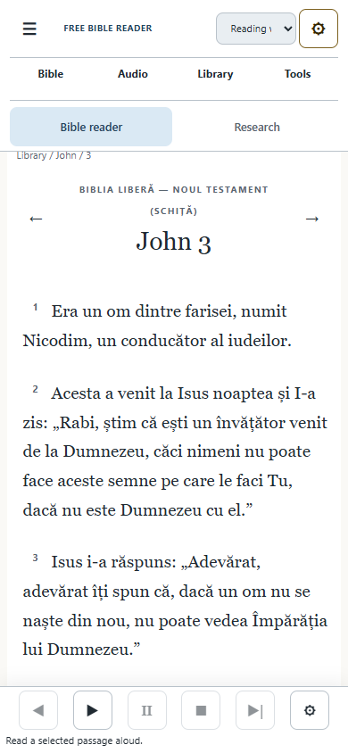

# FREE BIBLE READER

## Romanian voice recovery — Android Ultimate 0.3.1 Beta 1

[Download the repair and Romanian Voice Add-on](https://github.com/chatgptopenaiagi/Free-Bible-Reader/releases/tag/v0.3.1-beta.1)
· [Romanian voice installation guide](docs/ROMANIAN-VOICE-RECOVERY.md)

This focused Android update prevents a saved English voice from being used for
Romanian Scripture, discovers installed TTS engines explicitly, adds native
Android playback and provides bounded automatic recovery. A separate small
**Romanian Voice Add-on** supplies a genuine offline Android TTS service using
basic eSpeak synthesis. It is independent of Piper and the Bible databases.

The recommended recovery is to install the add-on, update Ultimate, then choose
**Audio → Voice Manager → Android system TTS** and select the add-on's Romanian
voice. No global TTS setting change is required. Piper Mihai remains available.
The update uses the same development signing certificate and application ID as
the published Ultimate preview; it does not clear personal libraries or settings.

**Physical Vivo V2450 testing was unavailable.** The repair is verified on the
ARM64 emulator runtime, including actual native playback completion. Digital
audio tests do not establish that a person heard the phone's loudspeaker.
Windows v0.2.0, Python v0.3.0 and the existing Lite release are unchanged.

## Android and Python preview — 0.3.0

The multiplatform prerelease provides two independent, offline Android apps and
an installable Python package. **Windows users should keep the verified
[Windows v0.2.0 release](https://github.com/chatgptopenaiagi/Free-Bible-Reader/releases/tag/v0.2.0).**

- **Lite:** a compact, mobile-first reader with English Scripture, the Romanian
  draft New Testament, book/chapter navigation, search, bookmarks and saved position.
- **Ultimate:** the larger reading and research studio, with all six public Bible
  and reference databases, three source-specific research engines, local speech
  resources, personal libraries and PDF/DOCX documents.
- **Python:** a pure-Python wheel with the public offline data, a real `fbr` CLI,
  reading/search/research services and optional document dependencies.

[Multiplatform downloads](https://github.com/chatgptopenaiagi/Free-Bible-Reader/releases/tag/v0.3.0-beta.1)
· [Installation and limitations](docs/MULTIPLATFORM.md)
· [Python commands](PYTHON-PACKAGE.md)

Android APKs are **development-signed testing builds**, not Play Store releases.
Android verification uses an emulator executing ARM64 code through translation;
it does not establish physical Vivo compatibility. Bundled voice models are
distinguished from tested synthesis and from audible pronunciation assessment.
The Romanian edition remains a **draft New Testament, not a complete Bible**.

## Windows reading studio — 0.2.0

A free, offline Windows Bible reader and personal study studio. Read English and Romanian Scripture, listen with local voices, search personal editions, keep private notes, and export editable DOCX or searchable PDF documents.

[Download Windows x64 v0.2.0](https://github.com/chatgptopenaiagi/Free-Bible-Reader/releases/tag/v0.2.0) · [Installation](docs/INSTALLATION.md) · [Library guide](docs/LIBRARY-GUIDE.md) · [Study and export](docs/STUDIO-GUIDE.md) · [Audio guide](docs/AUDIO-GUIDE.md) · [Verification](docs/VERIFICATION.md)

## Start with reading

Open the application, choose an edition, choose a book and chapter, and read. Previous/next chapter controls, a chapter grid, reading focus and saved position keep the ordinary reading journey simple. Change the interface between **English, Romanian and German** independently of the Scripture edition.

| Included Scripture | Books | Chapters | Source text units |
|---|---:|---:|---:|
| World English Bible, Protestant Edition | 66 | 1,189 | 31,103 |
| King James Version — CrossReferences source edition | 66 | 1,189 | 31,102 |
| Berean Standard Bible — CrossReferences source edition | 66 | 1,189 | 31,102 |
| Biblia Liberă — Romanian Latin-script **draft New Testament** | 27 | 260 | 7,958 |

**Biblia Liberă is under revision and does not include the Old Testament.** It is not a complete Romanian Bible. Personal editions may have different coverage and native verse labels. Original Scripture wording and numbering are preserved; matching references do not prove identical versification.

| Voice Manager | Selected-text research |
|---|---|
|  |  |

| Private library import | Narrow-screen reading |
|---|---|
|  |  |

## Listen offline

The permanent player reads selections, verses, chapters or a bounded book queue. Pause, stop, previous/next verse, speed, volume and spoken-reference preferences are under **Audio**.

- **Windows voices:** discover SAPI and Windows.Media voices actually installed on the computer. Missing Romanian Andrei is not advertised as installed.
- **Piper:** install the pinned Romanian **Mihai**, English **Joe** or German **Thorsten** model through **Audio → Voice Manager**. Each model needs an initial download of about 63 MB. Subsequent narration is local.
- **eSpeak NG:** the included lightweight fallback provides Romanian and other engine languages without a neural-model download.

No paid cloud API or account is required. Voice models are optional private data. Digital synthesis and browser playback were verified; physical speaker listening remains a separate check. [Provider availability and controls](docs/AUDIO-GUIDE.md).

## Study selected text

Select a phrase and right-click, or use **Shift+F10**, to read, search, compare, open cross-references, copy with its source, highlight, add a note, save to a collection or export. Source edition and selection boundaries remain attached to research items.

Advanced Search supports edition/book/testament filters, phrase/word/prefix/Boolean modes, and explicit exact-versus-folded diacritics. Save searches, history and selected results locally. Large scans have explicit budgets and report partial results honestly.

The three research engines provide graphical arcs, a weighted directed graph and translation-specific phrase references. KJV/BSB compatibility is explicit. WEB, Romanian and personal editions do not silently inherit those mappings. A cross-reference records a source's link, not theological equivalence.

## Bring your own library

The **Library** menu offers guided inspection, column mapping, preview and confirmed import for supported SQLite, CSV, JSON/JSONL, restricted SQL dumps and ZIP containers. The Windows-authenticated SQL Server connector reads an explicitly selected database without changing it. HTTPS downloads stage files first; import still requires confirmation.

The BIBLIA adapter can search source version records and import one selected edition without copying an entire multi-gigabyte corpus. Arbitrary schemas require mapping. SQL scripts and archived programs are never executed as operating-system commands. Native ranges, suffixes and nonnumeric chapter labels retain their source identity.

Personal originals, annotations, corrected copies, collections, exports and voices live separately under `%LOCALAPPDATA%\FreeBibleReader\studio`. They are not included in public releases. Corrections remain distinct from original Scripture snapshots. [Formats and limits](docs/LIBRARY-GUIDE.md).

## Documents and appearance

Export selections, verses, chapter(s), selected search results, comparisons, collections or notes to **editable DOCX** or **selectable PDF**, using Windows Save As or a browser download. Set paper, margins, typography, title, header/footer, page numbers and optional notes. PDF embeds licensed DejaVu fonts with verified Romanian diacritics.

Light, dark, system, sepia, high contrast and custom themes, separate reading/interface fonts and scales, reading width, spacing and flexible panels remain available. Phone/tablet viewport checks are browser emulation, not native mobile certification.

## Install and update

Download the setup EXE and checksum from the [v0.2.0 release](https://github.com/chatgptopenaiagi/Free-Bible-Reader/releases/tag/v0.2.0). End users need a Windows browser, not Python, Node.js or SQL Server. The package is unsigned; verify its published checksum without disabling security protections.

The launcher opens the local reader and companion window. **Close application** stops the server; closing only the browser tab leaves it running. The listener binds to `127.0.0.1`. Close the application before upgrading; retain the browser profile and local origin for saved reading/display preferences. Personal library data is outside the installation folder.

Historical [v0.1.1](https://github.com/chatgptopenaiagi/Free-Bible-Reader/releases/tag/v0.1.1) and [v0.1.0](https://github.com/chatgptopenaiagi/Free-Bible-Reader/releases/tag/v0.1.0) remain available.

## Source, verification and rights

[Development instructions](docs/DEVELOPMENT.md) describe modular Python/ES modules, pinned build inputs and separate installer checks. Public source contains no personal corpus, notes, credentials or downloaded voice models. Large immutable research inputs are restored from a pinned existing public release.

Our own code retains its [MIT license](LICENSE). Scripture, data and runtimes retain separate terms, including GPL speech components with a corresponding-source release asset. Read [THIRD-PARTY-NOTICES.md](THIRD-PARTY-NOTICES.md), [speech provenance](licenses/TTS-SOURCES.md) and [document/font notices](licenses/studio-documents-NOTICES.md). The combined distribution is not described as entirely MIT licensed.

[Issues](https://github.com/chatgptopenaiagi/Free-Bible-Reader/issues) · [Release notes](RELEASE-NOTES.md) · [Verification and limits](docs/VERIFICATION.md)
