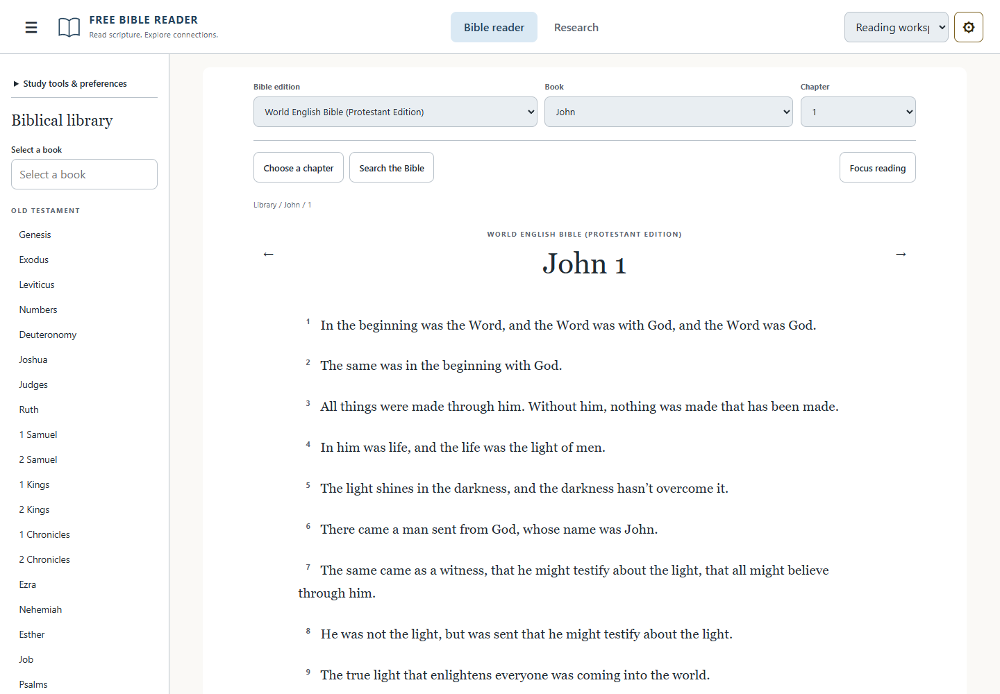
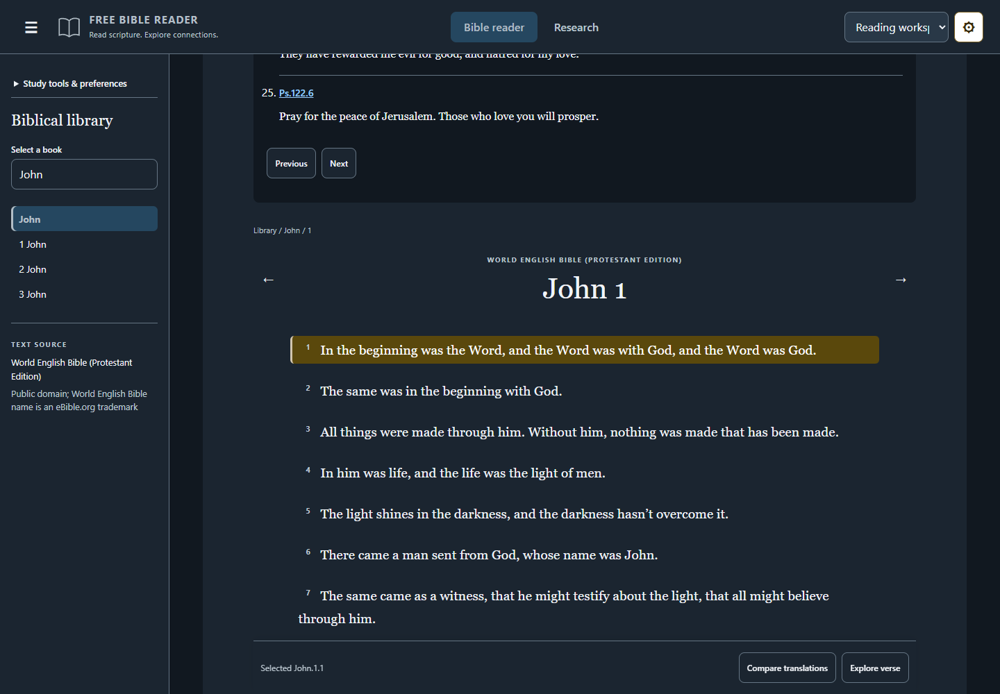
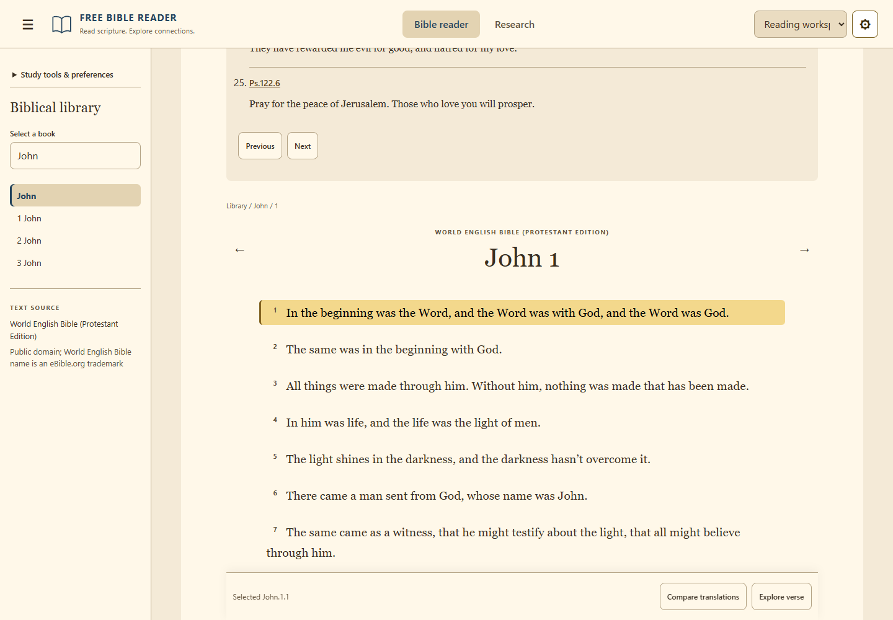
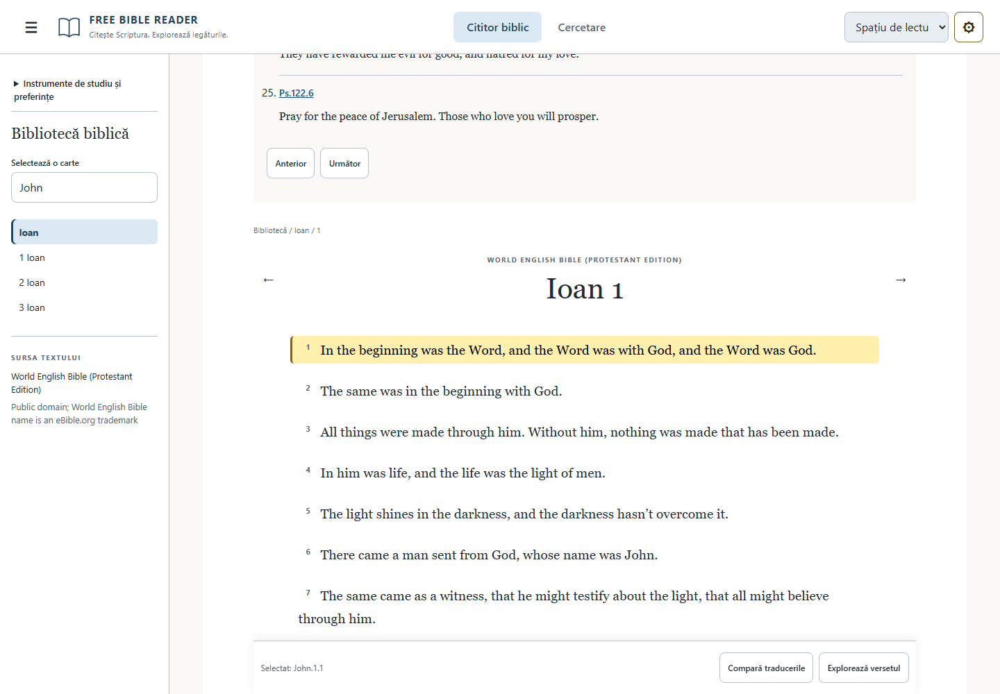
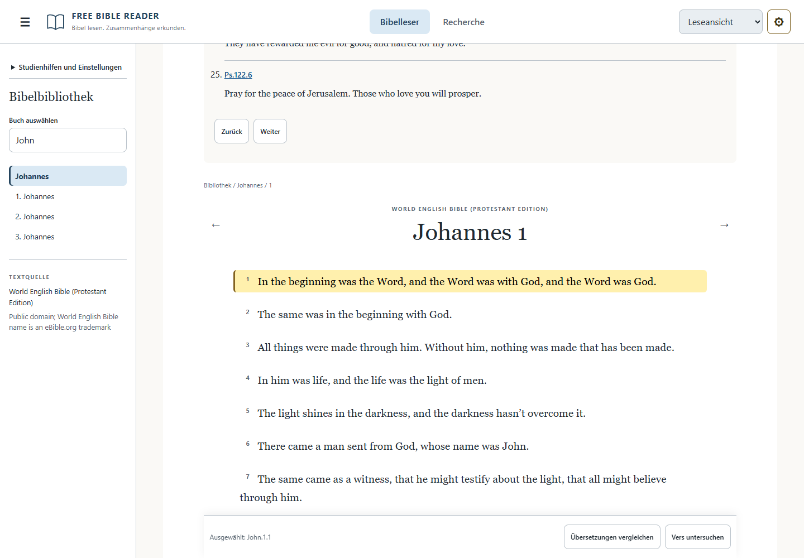
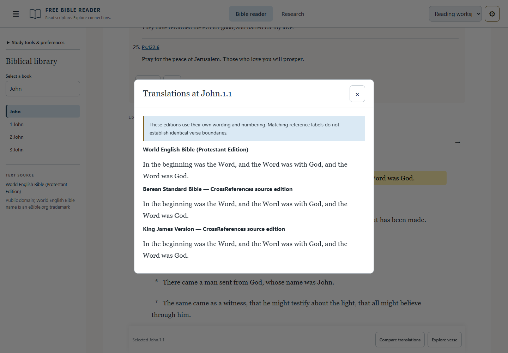
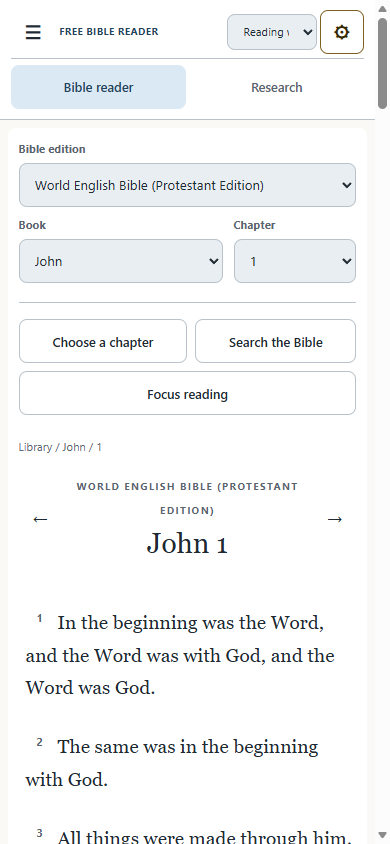

# FREE BIBLE READER

An offline Windows Bible reader with English, Romanian and German controls, complete English Scripture editions, local search and three independent cross-reference research views.

Read the **World English Bible (WEB)**, **King James Version (KJV)** and **Berean Standard Bible (BSB)** without sending your reading or search text to an online service.

[Installation](docs/INSTALLATION.md) · [Verification](docs/VERIFICATION.md) · [Development](docs/DEVELOPMENT.md) · [Release notes](RELEASE-NOTES.md) · [Licenses and attribution](THIRD-PARTY-NOTICES.md)

[Download the Windows x64 installer](https://github.com/chatgptopenaiagi/Free-Bible-Reader/releases/download/v0.1.1/Free-Bible-Reader-0.1.1-windows-x64-setup.exe) · [Version 0.1.1 release](https://github.com/chatgptopenaiagi/Free-Bible-Reader/releases/tag/v0.1.1)

The actual production application passed **68 reading-experience**, **24 existing acceptance** and **eight startup-recovery** checks, plus installation, integrity and lifecycle verification. See the [verification record](docs/VERIFICATION.md) for exact scope.

## Keep your place

Version 0.1.1 makes ordinary reading more continuous:

- **Resume reading:** save the native edition, book, chapter and visible or selected verse separately from appearance settings.
- **Change edition in context:** retain the book, chapter and verse where that edition supplies it; missing native positions are reported explicitly.
- **Navigate long chapters:** use the chapter grid, controls above and below the text, or keyboard shortcuts. Reading focus hides surrounding tools without discarding the workspace.
- **Search consistently:** result pages keep the query, edition and book filter that produced them, even while you edit the next query. Late responses cannot replace a newer passage.
- **Compare a selected verse:** open actual WEB, KJV and BSB text at the requested native coordinate. A visible note explains that the same reference label does not prove identical verse boundaries.
- **Use larger interface text:** revised settings keep close, reset and other controls reachable in narrow portrait and short landscape layouts.

The actual final production application passed **68/68 reading-experience scenarios** and **24/24 existing acceptance scenarios**. The checks include complete chapters, real searches, reading-position restoration and the corrected book→chapter flow. Its separate **8/8 startup-recovery checks** also passed. [Verification details](docs/VERIFICATION.md) separate those stages.

The application also provides a visible startup/retry surface if a local component fails to load. Its English, Romanian and German fallback messages do not depend on the translation catalogs, and readable fallback colors do not depend on the application stylesheet. There is no automatic reload loop. Final installed failure/retry scenarios passed in all three interface languages.

## Read comfortably, research with context

- Three included English reading editions, each with 66 books and 1,189 chapters.
- Local full-text search, optional book filtering and direct passage navigation.
- A visual graph, aggregate cross-reference graph and phrase-level research, each retaining its source records and direction.
- English, Romanian and German interface controls. Interface language leaves Scripture wording and source identities unchanged.
- Light, dark, system, sepia, high-contrast and custom themes; seven palettes and fourteen editable color categories.
- Twelve font stacks, separate interface and Scripture scales, line and paragraph spacing, reading width and adjustable research workspaces. Glyph coverage depends on locally installed fonts.
- A complete Windows package with its application runtime, parser and research assets. End users do not need Python, Node.js, a database server or another Bible library.

The desktop launcher opens your browser and a small companion window. **Open reader** returns to the local page; **Close application**, or the companion window's close button, stops the application. Closing only the browser tab leaves the companion running. The listener binds to `127.0.0.1`.

## Included Scripture

| Reading edition | Books | Chapters | Source verse rows |
|---|---:|---:|---:|
| World English Bible, Protestant Edition | 66 | 1,189 | 31,103 |
| King James Version — CrossReferences source edition | 66 | 1,189 | 31,102 |
| Berean Standard Bible — CrossReferences source edition | 66 | 1,189 | 31,102 |

All **93,307** distributed text records passed exact source comparison for 0.1.0. The five SQLite assets are unchanged in 0.1.1 and pinned in the portable [build-input manifest](data/build-inputs.json). Native numbering is retained, including WEB's Romans 14:24–26 and Romans 16 ending at verse 25. Matching chapter or verse labels do not establish identical segmentation between editions.

## Research without hiding the source

The visual and aggregate graphs use KJV coordinates. The phrase engine also has its own BSB and Afrikaans AOV sources; AOV is a research source, not a fourth main-reader edition. Unsupported BSB/AOV graph mappings are reported explicitly. WEB reading does not automatically become KJV research.

Incoming and outgoing links, weights, phrase context and original source records help distinguish a dataset's assertion from a reader's interpretation. Cross-references do not certify theological agreement or historical transmission. See [dataset attribution](THIRD-PARTY-NOTICES.md) for revisions, derivations and rights.

## Windows package and screenshots

The complete per-user Windows x64 installer is **171,933,773 bytes**, SHA-256 `690b384125667c1816b579f7ab006e52b6bd001bdc3153cd7a4d97b916b02059`. Windows 11 x64 was used for the recorded installation, reading and research checks. The package is unsigned; compare the exact published asset/checksum before running it. End users do not need the separate developer research ZIP.

These are actual screenshots from the final production 0.1.1 application, not mockups. Thirteen PNGs were validated; the twelve suite captures remain unchanged, and one additional clean mobile reading view uses the actual GUI at default typography. The preserved 0.1.0 screenshots remain in the repository history and original paths.

| Dark reading | Sepia reading |
|---|---|
|  |  |

| Romanian controls | German controls |
|---|---|
|  |  |

| Actual translation comparison | Narrow-screen reading |
|---|---|
|  |  |

Additional captures: [Genesis 1](screenshots/v0.1.1/production-reading-final/genesis1.png), [selected John 1](screenshots/v0.1.1/production-reading-final/john1.png), [light theme](screenshots/v0.1.1/production-reading-final/light.png), [search results](screenshots/v0.1.1/production-reading-final/search.png), [research source records](screenshots/v0.1.1/production-reading-final/research.png), and the [larger-type mobile test state](screenshots/v0.1.1/production-reading-final/mobile.png).

Narrow-screen captures are browser viewports, not physical Android/iPhone or native-app certification. Research/search images show their actual scrolled results state. The [verification record](docs/VERIFICATION.md) distinguishes suite, lifecycle and startup coverage.

## Open source and data rights

The application's own code is [MIT licensed](LICENSE). Scripture, datasets and bundled runtimes retain separate rights and attribution. The KJV has a territorial rights notice; research materials include CC BY and a separately identified GPL electronic-source layer. Read [THIRD-PARTY-NOTICES.md](THIRD-PARTY-NOTICES.md) before redistributing a bundle.

Git includes the compact reader database and reference seed. Larger research databases and the Node executable are separate developer build inputs. The complete installer already supplies them. Version 0.1.1 reuses the checksum-verified 0.1.0 research asset; installer users do not need a separate research-data download. [Development instructions](docs/DEVELOPMENT.md) explain source restoration and explicit build phases.

[Source repository](https://github.com/chatgptopenaiagi/Free-Bible-Reader) · [Issue tracker](https://github.com/chatgptopenaiagi/Free-Bible-Reader/issues)
