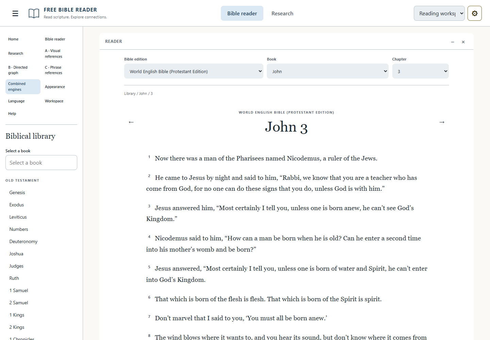
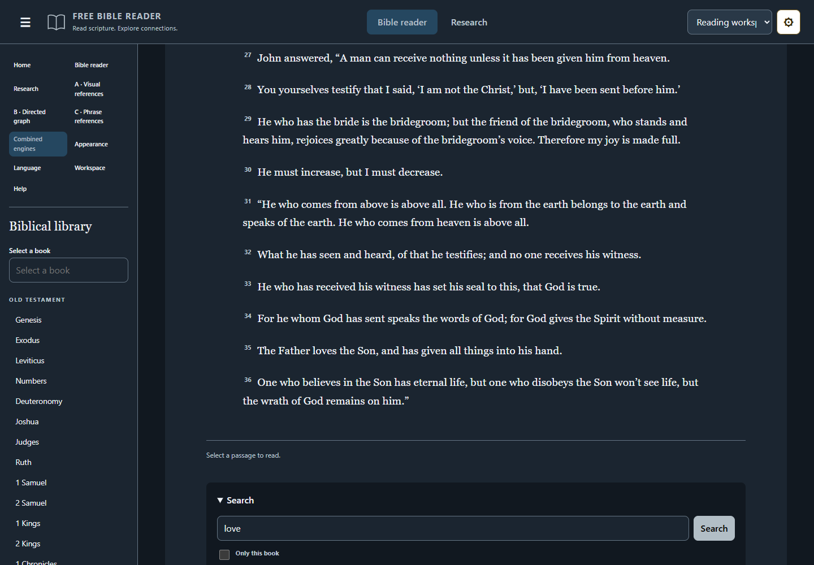
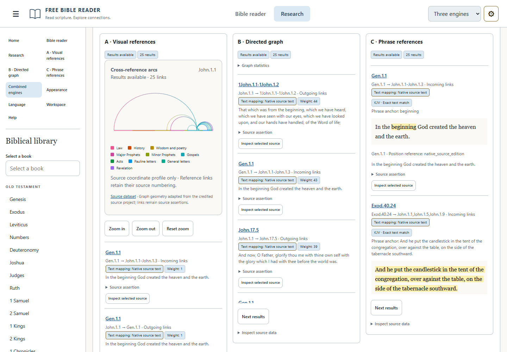
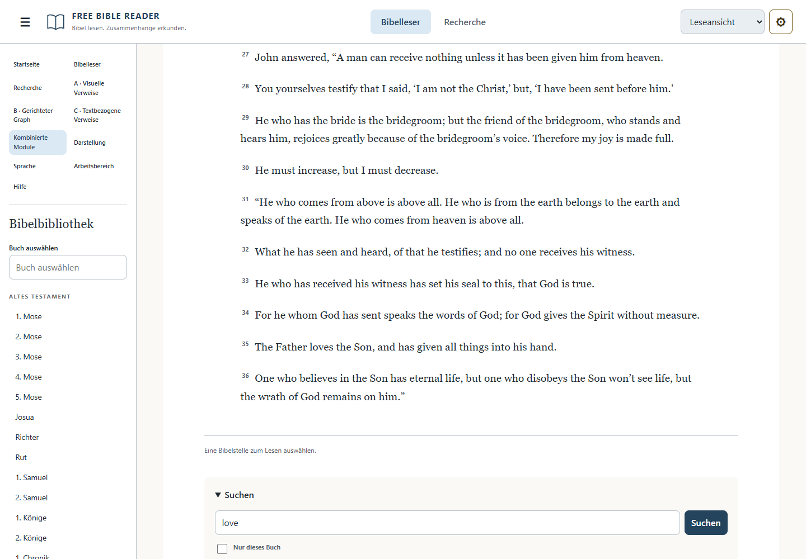
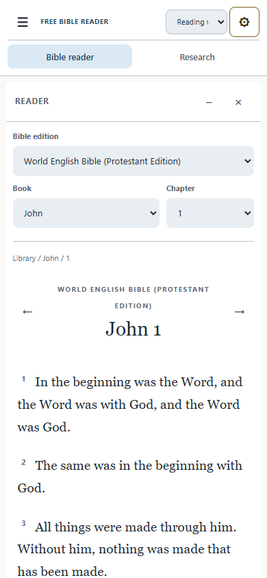
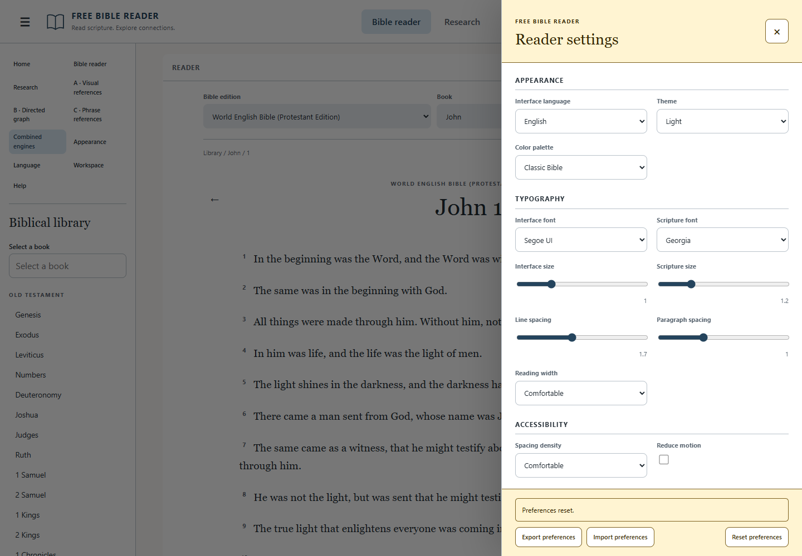
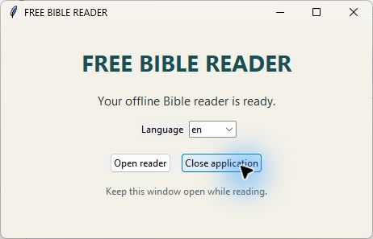

# FREE BIBLE READER

An offline Bible reader for Windows with English, Romanian and German interface options, full-text Scripture search and three independent cross-reference research views.

Read the **World English Bible (WEB)**, **King James Version (KJV)** and **Berean Standard Bible (BSB)** locally. Choose a book and chapter, move through the text, search passages, and adjust the reading surface without sending the text to an online service.

[Windows installer](https://github.com/chatgptopenaiagi/Free-Bible-Reader/releases/download/v0.1.0/Free-Bible-Reader-0.1.0-windows-x64-setup.exe) · [Installation](docs/INSTALLATION.md) · [Verification](docs/VERIFICATION.md) · [Source and development](docs/DEVELOPMENT.md) · [Licenses and attribution](THIRD-PARTY-NOTICES.md)

## Read comfortably, research with context

- **Three included English reading editions:** 66 books and 1,189 chapters per edition, with source verse numbering preserved.
- **Local full-text search:** search a chosen edition, narrow results by book and open the matching chapter.
- **Three research views:** a visual graph, an aggregate cross-reference graph and phrase-level relationships, each with its own source attribution and direction.
- **English, Romanian and German controls:** changing the interface language leaves Scripture wording and source identities unchanged. The included reading translations remain English.
- **Six themes:** light, dark, system, sepia, high contrast and custom; seven palette choices and fourteen editable color categories.
- **Adjustable typography:** twelve selectable font stacks, separate interface and Scripture scales, line and paragraph spacing, and reading width. Available glyphs depend on locally installed fonts.
- **Flexible workspaces:** single, dual, triple, research and reading layouts with panel visibility, collapse state and sizes remembered in browser preferences.
- **Offline operation:** the Windows package includes the application runtime, parser and research assets. End users do not need to install Python, Node.js, a database server or an additional Bible library.

The desktop launcher opens a local browser page and a small companion window. Use **Open reader** to return to the page and **Close application** to stop the local application. The listener binds to `127.0.0.1`; it is not a public web service.

## Included Scripture

| Reading edition | Books | Chapters | Source verse rows |
|---|---:|---:|---:|
| World English Bible, Protestant Edition | 66 | 1,189 | 31,103 |
| King James Version — CrossReferences source edition | 66 | 1,189 | 31,102 |
| Berean Standard Bible — CrossReferences source edition | 66 | 1,189 | 31,102 |

All 93,307 included text records passed exact comparison with the packaged source records. Native numbering is retained, including WEB’s Romans 14:24–26 and Romans 16 ending at verse 25. A chapter label in one edition is not treated as proof of identical segmentation in another.

## Research without hiding the source

The three engines expose distinct source models rather than combining every result into an unexplained score. The visual and aggregate graphs use KJV coordinates. The phrase engine has its own KJV, BSB and Afrikaans AOV source editions; AOV is a research source rather than a fourth edition in the main reader. BSB/AOV research does not invent mappings into the other two graphs. WEB reading does not automatically become KJV research.

Incoming and outgoing links, source weights, source records and phrase context help distinguish what a dataset asserts from what a reader may infer. Cross-reference links can support study; they do not certify a theological interpretation or historical transmission. See the [attribution and dataset notes](THIRD-PARTY-NOTICES.md) for the source revisions and public derivations.

## Windows desktop release

Download **[FREE BIBLE READER 0.1.0 for Windows x64](https://github.com/chatgptopenaiagi/Free-Bible-Reader/releases/download/v0.1.0/Free-Bible-Reader-0.1.0-windows-x64-setup.exe)** (approximately 164 MiB). The installer contains all three reading editions, the three research engines and their runtimes; the separate research-data ZIP is for source developers.

The per-user installer targets Windows x64 and does not require administrator installation. The build is unsigned, so Windows may display an unknown-publisher or reputation notice. Check the release source and published SHA-256 before deciding whether to run a package. Actual installation, installed reading/search/research, clean shutdown and isolated uninstallation passed. The installed reader also passed all nine self-test checks with host Python and Node removed from PATH. See the [verification record](docs/VERIFICATION.md) for test counts and limits.

The responsive layout has browser-based desktop and narrow-screen checks. Native Android/iOS applications and other desktop platform binaries are not included or certified.

## Screenshots

These screenshots show the application, not mockups.

| Dark reading | Cross-reference research |
|---|---|
|  |  |

| Romanian interface | German interface |
|---|---|
|  |  |

| Narrow viewport | Reader settings |
|---|---|
|  |  |

## Open source and data rights

The application’s own code is [MIT licensed](LICENSE). Scripture editions, datasets and packaged runtimes retain their separate rights and attribution. The KJV has a territorial rights notice; the research materials include CC BY and a separately identified GPL electronic-source layer. See [THIRD-PARTY-NOTICES.md](THIRD-PARTY-NOTICES.md) before redistributing a bundle.

The Git source includes the compact reader database and reference seed. The three larger research databases and the Node executable are separate release/build inputs; cloning the repository alone does not download them. [Development instructions](docs/DEVELOPMENT.md) explain the explicit checksum-verified research asset workflow.

[Source repository](https://github.com/chatgptopenaiagi/Free-Bible-Reader) · [Issue tracker](https://github.com/chatgptopenaiagi/Free-Bible-Reader/issues)
